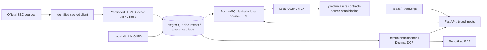

# Architecture

`ingestion.py` handles source access, normalized HTML and annual fact selection; `db.py` stores provenance. `search.py` compares PostgreSQL English full-text retrieval with MiniLM cosine similarity plus reciprocal-rank fusion (constant 60). With 2,851 passages, cosine calculation in NumPy is simpler than introducing pgvector. It loads only the chosen company's date-filtered corpus. The v1.1 search expands general disclosure topics and reranks by specificity to reduce boilerplate and wrong-section matches. It uses no question-ID or company-specific answer table. Search returns five hits; prose generation uses the top three to bound context.

`scope.py` conservatively gates unsupported capabilities (market prices, forecasts, monthly data, private topics) and explicit mismatched question subjects before inference. This is a heuristic capability gate, not a general entity recognizer or a guarantee of semantic safety.

`research.py` is a fixed bounded workflow, not an agent framework. `finance.py` interprets supported financial intents and builds canonical measures from the verified ledger. A local-model proposal must contain the exact target set, source input IDs, actual period dates, company, scope, definition, unit and direction; values allow only two-decimal rounding tolerance. Well-formed inconsistent proposals are rejected immediately. A single bounded model repair is available for malformed structure. Parsing may normalize exactly one missing final outer brace after a complete array, never missing values or brackets.

Accepted numerical wording is rendered from canonical code data. Rejections display no model conclusion and keep verified records accessible. `historical` retains observations and resolves identity before computing: no last-write-wins. Non-USD and segment observations remain distinguishable; competing definitions, fiscal dates, values or reporting bases block the metric. An explicit restatement link does not authorize silently discarding the original. Curated original filings currently have `as_reported` basis; broader restatement acquisition is not implemented.

For qualitative questions, the model writes the prose and selects source-span identifiers. `grounding.py` resolves these to exact original excerpts and validates citation membership, fiscal references and the numeric-prose gate. This prevents fabricated quotes but does not prove inference, full support or completeness. An explicit ambiguous prose conflict requires two distinct verified source spans and abstention. The small model can still fail to recognize a narrative contradiction; deterministic conflict detection is limited to structured observations.

`run_dcf_scenario` remains a typed deterministic API operation. The LLM cannot execute code, SQL, shell commands, arbitrary URLs or tools.

Document content and questions are untrusted data in a user message, subordinate to the fixed system policy. Injection tests check role separation and literal output markers, with no sensitive tool capability available. This is defense in depth, not a claim that language models are immune to prompt injection.

`finance.py` owns all ratios and forecast arithmetic. The UI only formats returned values and draws cash-flow bars from API output. `report.py` calls the same functions. Forecast assumptions are included in each PDF request; export verifies base revenue against the published Apple fact at the selected date. Model narrative is deliberately excluded from the PDF, avoiding stale AI paragraphs after scenario changes.

`evaluation.py` imports frozen references only to score results after generation. Generation receives actual retrieved evidence and deterministic calculations, never the reference answer. Real inference is a separate command. `tests/` and browser mocks provide deterministic CI and are clearly labeled.

Migrations use Alembic; the initial revision defines the PostgreSQL schema and its GIN text index. Embeddings are JSONB arrays to keep storage transparent. Model snapshots and normalized text live in ignored `data/`; runtime metadata paths are machine-specific. No uploaded source, account system or external model vendor is exposed.

Tradeoffs: only annual, consolidated USD data; editorial risk paragraph in the note; small-model semantic entailment is not established at runtime; no robust public multi-user service; corpus-size scaling, automatic restatement acquisition, lease adjustments and equity bridges are outside V1.

The MLX adapter owns a persistent single-thread executor. MLX imports, model loading, stream generation and cache cleanup all run on that thread; FastAPI workers only submit bounded generation requests. A mutex rejects overlapping generation. This addresses the pinned runtime's thread-affine GPU streams, rather than relying on request-pool thread reuse. The local HTTP adapter remains separate.
