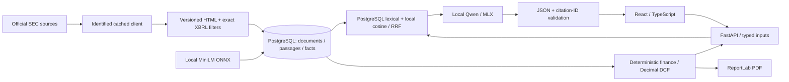

# Architecture

`ingestion.py` handles source access, normalized HTML and annual fact selection; `db.py` stores provenance. `search.py` compares PostgreSQL English full-text retrieval with MiniLM cosine similarity plus reciprocal-rank fusion (constant 60). With 2,851 passages, cosine calculation in NumPy is simpler than introducing pgvector. It loads only the chosen company's date-filtered corpus. There is no reranker because no measured case justifies one.

`scope.py` conservatively gates unsupported capabilities (market prices, forecasts, monthly data, private topics) and explicit mismatched question subjects before inference. This is a heuristic capability gate, not a general entity recognizer or a guarantee of semantic safety.

`research.py` is a fixed bounded workflow, not an agent framework. Typed `search_documents`, `get_financial_facts` selection and `calculate_metrics` feed the model. Recognized financial questions augment both retrieval variants with the same exact source-linked fact records. `run_dcf_scenario` is a typed deterministic API operation. The LLM cannot execute code, SQL, shell commands, arbitrary URLs or tools. JSON output and citation membership are validated; that does not establish entailment.

Document content and questions are untrusted data in a user message, subordinate to the fixed system policy. Injection tests check role separation and literal output markers, with no sensitive tool capability available. This is defense in depth, not a claim that language models are immune to prompt injection.

`finance.py` owns all ratios and forecast arithmetic. The UI only formats returned values and draws cash-flow bars from API output. `report.py` calls the same functions. Forecast assumptions are included in each PDF request; export verifies base revenue against the published Apple fact at the selected date. Model narrative is deliberately excluded from the PDF, avoiding stale AI paragraphs after scenario changes.

`evaluation.py` imports frozen references only to score results after generation. Generation receives actual retrieved evidence and deterministic calculations, never the reference answer. Real inference is a separate command. `tests/` and browser mocks provide deterministic CI and are clearly labeled.

Migrations use Alembic; the initial revision defines the PostgreSQL schema and its GIN text index. Embeddings are JSONB arrays to keep storage transparent. Model snapshots and normalized text live in ignored `data/`; runtime metadata paths are machine-specific. No uploaded source, account system or external model vendor is exposed.

Tradeoffs: only annual, consolidated USD data; editorial risk paragraph in the note; small-model citation support is not validated at runtime; no robust public multi-user service; corpus-size scaling, restatement views, lease adjustments and equity bridges are outside V1.
