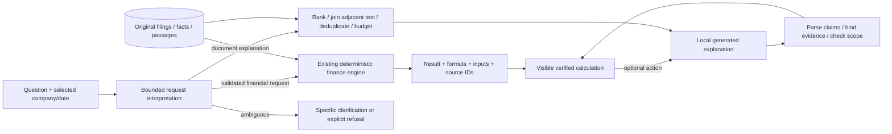

# ResearchDesk v1.2 — technical interview guide

## What the product actually does

ResearchDesk answers bounded questions about six original annual SEC filings: Apple, Dell and HP, FY2023–FY2024, filtered by publication date. It calculates supported financial metrics from source-linked consolidated USD observations and generates optional document explanations locally. It has no trading feed, investment recommendations, hosted inference, public ingestion or model-written tools.

## Why financial execution changed

In v1.1, a correct server calculation could still be hidden because the small model failed to copy its entire typed object back. All six blocked final cases had resolved ledger data. Original raw proposals were not retained; an instrumented immutable-code replay exposed truncated JSON and nested objects in place of assertions. Those replay causes are not claimed as the original raw failures.

v1.2 uses a `FinancialRequest`: company, metric(s), fiscal years, allowed operation, display unit, consolidated scope, definition and explicit/latest period selection. Interpretation is a bounded grammar followed by Pydantic validation. It is not a general natural-language parser. Missing periods, unspecified cash-flow/margin definitions, currency conversion, unsupported scope and unrecognized arithmetic trigger clarification or refusal. Mixed monetary/derived formulas are requested separately rather than silently dropping part of the question.

Execution reuses `finance.py`. The server creates the canonical operation; the model never generates executable code, SQL, a tool name or arithmetic. Input periods, reporting bases, concepts and provenance must be compatible. Output includes formula, exact inputs, display units, original dates and source identifiers. Decimal arithmetic owns ratios, changes and monetary conversion; the frontend only formats results.

The AI explanation is a separate result with a separate origin/status. Its failure, timeout, invalid financial direction or transport error cannot invalidate or hide a calculation already verified. Financial requests do not acquire the inference semaphore. This improves product coverage and latency by removing an unnecessary gate; it is **not improved numerical reasoning by the LLM**.

## Why retrieval and context are separate measurements

Search@5/8 does not tell us what the generator actually saw. v1.1 truncated to three passages and broke them into 220-character slices. This could remove a consequence or attach a claim to a heading. The HP digitization sentence crosses two passage boundaries: discarding each incomplete fragment independently removed the relevant disclosure.

The development comparison separates legacy three-passage fragments, complete sentences, and deduplicated adjacent context. Focused ranking uses query-specific inverse document frequency to recover continuations that lack the earlier topic noun. It does not use question IDs, company-specific answer tables or gold answers. Explicit printing/privacy topics outrank incidental supplier vocabulary.

Adjacent text is joined only inside the same document, publication window and normalized offset sequence with exactly one missing whitespace character. A reconstructed sentence keeps every exact source fragment, passage ID and offset. Joining does not create missing words. Near-duplicate sentences are removed to conserve the context budget. The selected explanation context uses at most four complete sentences; omissions and the actual transmitted text are retained in the audit.

The hard input budget is 2,400 model-tokenizer tokens including reserved template overhead; output is at most 650 tokens; total inference is bounded to 90 seconds. Optional financial context is charged to the same budget. One local generation runs at a time. Memory is measured on the target 8 GiB M1; process RSS and MLX allocator peaks are reported separately because they are not independent totals.

## What citation validation proves

The model produces short labeled assertions: disclosed information or cautious interpretation, each with evidence references. The server parses formatting and resolves only supplied evidence IDs. It does not author substitute model claims. Whole sentences crossing a passage boundary bind to both original fragments. Numerical financial claims are restricted to the deterministic route.

These checks establish source identity, scope and exact text presence. They do **not** prove that a source supports the whole claim, that an inference is justified, that labels are correct, or that the answer is complete. The model's disclosure/interpretation labels remain model labels. Coding-agent assessment is separate from independent human review; the latter remains pending until a person completes the grid.

## How conflicting data is handled

No later filing wins by recency. The ledger distinguishes company, exact period, unit/currency, consolidated/segment scope, concept and reporting basis. Eligible same-metric disagreements remain unresolved and both proofs are exposed; dependent calculations stop. Currency and segment observations cannot substitute for a consolidated USD observation. Explicit restatement metadata is curated, not assigned by the LLM. The current official corpus contains originals, not an exhaustive restatement history. Synthetic fixtures test incompatible contexts without modifying the demo database or pretending they are conflicting SEC disclosures.

## How to defend the evaluation

Old cases are diagnostics/replays. Development retains every attempted protocol, malformed output, false refusal and model comparison. Context ablations use the same questions and declared budgets. The baseline v1.1 code is immutable; a different financial result mode is named explicitly in comparisons.

After development, correction code is committed, final cases are written and frozen before execution, and source/case hashes are checked. Final questions have no exact overlap with earlier batches. The corpus is familiar and the batch is coding-agent-authored, so it is not an independent blind benchmark. A replay is labeled a replay, including after an incomplete execution. No best response is selected from undeclared tries.

Coverage on answerable questions, accepted numeric accuracy, false refusals/acceptances, source identity, semantic support, completeness and latency are separate measures. Exact-citation success is not a semantic score. Human-review packets contain actual outputs, passages and blank judgment fields. Deterministic CI uses explicit test doubles; actual local inference is a separate run.

## Useful interview questions

- **Why no autonomous agent framework?** The task has a bounded corpus and a small operation set. A fixed typed workflow is easier to inspect, test and constrain.
- **Why not ask the model to calculate?** It adds failure modes and latency to already verified arithmetic. The model adds document explanation, not numerical authority.
- **Why not just change the model?** The six blockers were an architecture/format problem; the HP evidence loss was a context problem. A model comparison is a separate measured development experiment, including memory and latency.
- **What remains weak?** Bounded language interpretation, qualitative completeness and citation entailment can still fail. A local small benchmark does not establish general financial-analyst competence.
- **What happens if AI is unavailable?** Verified calculations remain useful, sourced and exportable. Generated commentary has an explicit unavailable/rejected state.
- **How is it reproducible?** Original accession/date/hash manifests, pinned model/embedding revisions, locked dependencies, append-only evaluation records, frozen source hashes, PostgreSQL/Chromium CI and the scripted actual 90-second demonstration.
